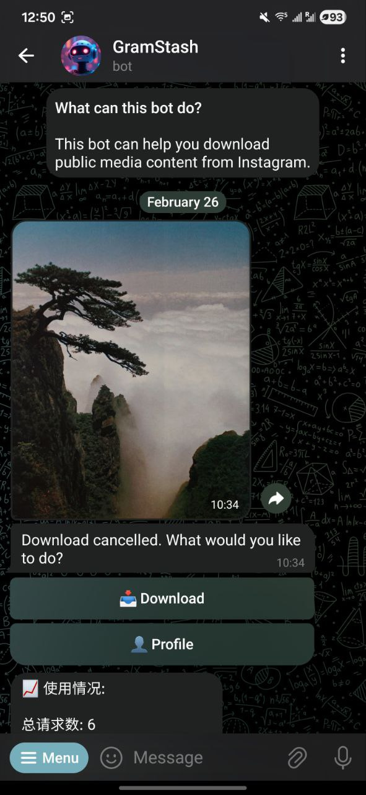
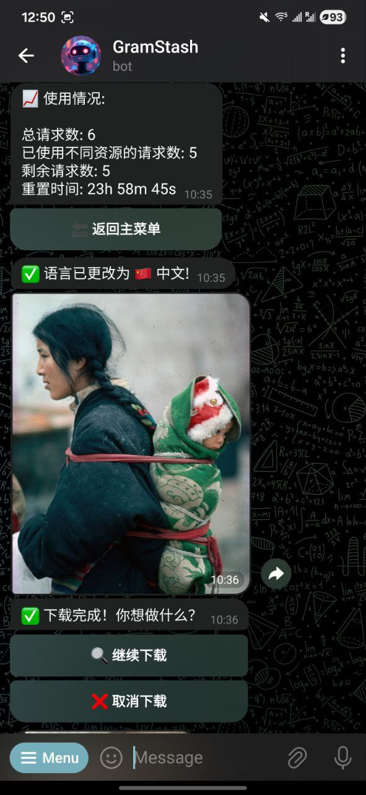
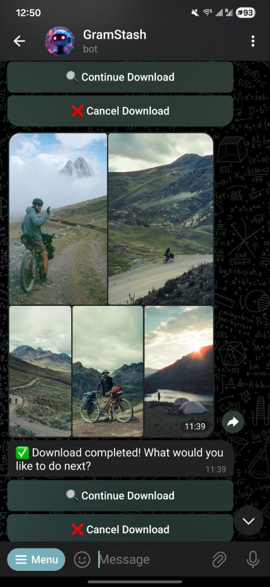
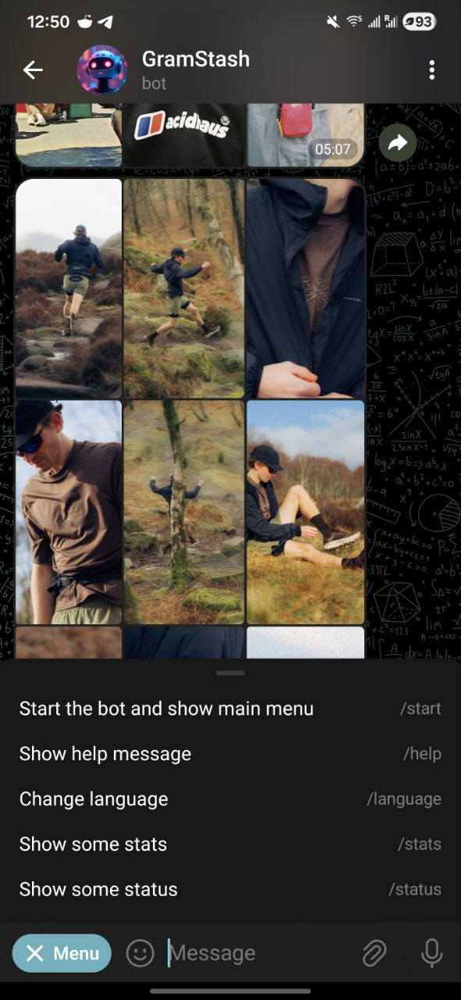

# GramStash (An Instagram Media Downloader) 🤖

[](https://github.com/escwxyz/gramstash/actions/workflows/test.yml)
[](https://codecov.io/gh/escwxyz/gramstash)

A Telegram bot that allows users to download media content from Instagram, including posts, reels, and stories. Built with Rust for performance.

> **NOTE** It's a proof of concept project, far away from completion. It is working for posts and reels, downloading stories requires user authentication which is unsafe to do here in Telegram. To deploy it, you need to set up a Shuttle account, use it at your own risk.

## Demos 🌠






## Features 🌟

- Download Instagram posts and reels
- Rate limiting & Cache, powered by Upstash
- Access and download Instagram stories (Coming soon)
- Private chat only (no group chat support)
- Secure authentication handling (Coming soon)
- Redis support for session storage, powered by Upstash
- Shuttle for easy deployment

## Getting Started 🚀

### Prerequisites

- Rust 1.75 or higher
- A Telegram Bot Token (get it from [@BotFather](https://t.me/botfather))
- [Upstash](https://upstash.com/) account (for Redis and Rate Limiting)
- [Shuttle](https://shuttle.dev/) account (for deployment)
- [Turso](https://turso.tech/) account (for user language storage)

### Environment Variables

Create a `Secret.toml` file in the root directory:

```toml
UPSTASH_REDIS_HOST = "your-redis-host"
UPSTASH_REDIS_PASSWORD = "your-redis-password"
UPSTASH_REDIS_PORT = "your-redis-port"
TELEGRAM_BOT_TOKEN = "your-telegram-bot-token"
INSTAGRAM_API_ENDPOINT = "https://www.instagram.com/graphql/query/"
INSTAGRAM_DOC_ID = "your-instagram-doc-id"
RATE_LIMIT_DAILY_LIMIT = "your-rate-limit-daily-limit"
RATE_LIMIT_WINDOW_SECS = "your-rate-limit-window-secs"
CACHE_EXPIRY_SECS = "your-cache-expiry-secs"
DIALOGUE_USE_REDIS = "true to use redis, false to use in-memory"
DIALOGUE_CLEAR_INTERVAL_SECS = "your-dialogue-clear-interval-secs"
SESSION_REFRESH_INTERVAL_SECS = "your-session-refresh-interval-secs"
TURSO_URL = "your-turso-database-url"
TURSO_TOKEN = "your-turso-token"
```

## Architecture 🏗️

```
src/
├── storage/                    # Storage Layer (Base Layer)
│   ├── mod.rs
│   ├── redis/                 # Redis implementations
│   │   ├── mod.rs
│   │   ├── queue.rs
│   │   ├── cache.rs
│   │   └── session.rs
│   └── turso/                 # SQL implementations
│       ├── mod.rs
│       ├── user.rs
│       └── metrics.rs
│
├── runtime/                   # Runtime Layer (Thread Management)
│   ├── mod.rs
│   ├── worker/               # Worker thread pools
│   │   ├── mod.rs
│   │   ├── download.rs
│   │   └── background.rs
│   ├── queue/                # Queue implementations
│   │   ├── mod.rs
│   │   └── priority.rs
│   ├── server/               # HTTP server
│   │   ├── mod.rs
│   │   ├── routes/
│   │   └── middleware/
│   └── cache/                # Cache management
│       ├── mod.rs
│       └── media.rs
│
├── services/                 # Core Services Layer
│   ├── mod.rs
│   ├── metrics/
│   │   ├── mod.rs
│   │   └── collector.rs
│   ├── ratelimit/
│   │   ├── mod.rs
│   │   └── upstash.rs
│   ├── auth/
│   │   ├── mod.rs
│   │   └── session.rs
│   └── payment/
│       ├── mod.rs
│       └── stripe.rs
│
├── platforms/               # Platform Layer
│   ├── mod.rs
│   ├── traits.rs           # Common platform traits
│   ├── instagram/
│   │   ├── mod.rs
│   │   ├── api.rs
│   │   ├── models.rs
│   │   └── download.rs
│   └── tiktok/            # Future extension
│       ├── mod.rs
│       └── api.rs
│
├── handlers/              # User Interface Layer
│   ├── mod.rs
│   ├── command/
│   ├── callback/
│   └── message/
│
└── core/                 # Core Types & Utils
    ├── mod.rs
    ├── error.rs
    ├── config.rs
    └── state.rs
```

## Roadmap 🛣️

### Basic Features

- [x] Redis integration
- [x] Rate limiting
- [x] Dialogue state management
- [x] Session management
- [x] Localization
- [x] Job queue
- [ ] Background task scheduling
- [ ] Membership & Payment
- [ ] Session
- [ ] User Configuration
- [ ] User Statistics
- [ ] Admin

### Platforms

#### Instagram

- [x] Image & Reel post downloading
- [ ] Story downloading
- [ ] Highlight downloading
- [ ] Profile based bulk downloading

#### Youtube

- [ ] Video downloading
- [ ] Shorts downloading
- [ ] Playlist downloading
- [ ] Video to Audio conversion

#### BiliBili

- [ ] Video downloading
- [ ] Video to Audio conversion
- [ ] Playlist downloading

...

## Contributing 🤝

Contributions are welcome! Please feel free to submit a Pull Request. For major changes, please open an issue first to discuss what you would like to change.

1. Fork the repository
2. Create your feature branch (`git checkout -b feature/AmazingFeature`)
3. Commit your changes (`git commit -m 'Add some AmazingFeature'`)
4. Push to the branch (`git push origin feature/AmazingFeature`)
5. Open a Pull Request

### Development Guidelines

- Follow Rust coding conventions
- Add tests for new features
- Update documentation as needed
- Keep commits clean and well-documented

## Known Issues 🐛

- Due to the current limitation of `teloxide_tests`, we either have to use the default `Bot` in `BotService` without any adapters or temporarily disable the tests. See [here](https://github.com/LasterAlex/teloxide_tests/issues/25) for more details.
- ~~User input is automatically processed by Telegram, currently we restore the display text back to the raw text, which is most likely not the perfect solution.~~

## Security 🔒

- User credentials are never stored permanently
- Messages containing sensitive information are automatically deleted
- Session tokens are stored securely
- Group chat access is blocked

## License 📝

This project is licensed under the Apache 2.0 License.

See the [LICENSE](LICENSE) file for the complete license text.

## Acknowledgments 👏

- [Teloxide](https://github.com/teloxide/teloxide) - Telegram Bot Framework

## Support 💬

For support, please open an issue.

## Disclaimer ⚠️

This bot is not affiliated with Instagram or Meta. The codebase is only for educational purposes. Use it responsibly and in accordance with Instagram's terms of service. You are responsible for your own actions.
